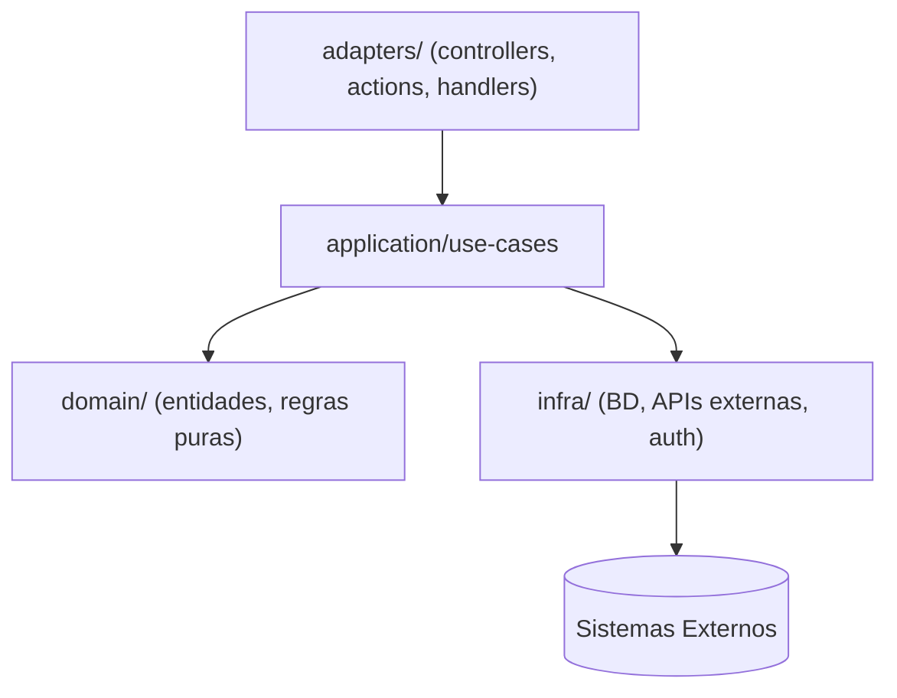

# Guia de Arquitetura

Arquitetura de referência e stack deste workspace. Todo agente deve ler este arquivo antes de tomar uma decisão técnica.

> Detalhes de implementação: `backend-guidelines.md` e `frontend-guidelines.md`.
> Nomenclatura e convenções de código: `conventions.md`.

---

## Stack

**Não fixa por padrão.** Este é um template em branco — na primeira vez que um projeto real passar pelo `.ai/agents/architect.agent.md`, o Architect preenche a tabela abaixo com a stack confirmada, e este arquivo passa a ser a referência vinculante para toda feature seguinte.

| Camada | Tecnologia |
|-------|-----------|
| Linguagem | _(a definir)_ |
| Framework | _(a definir)_ |
| Banco de dados | _(a definir)_ |
| Testes | _(a definir)_ |
| Lint/Format | _(a definir)_ |

---

## Arquitetura Padrão: Em Camadas / Clean Architecture

Padrão agnóstico de linguagem. Use este formato a menos que o Architect documente um desvio (com uma entrada no histórico de decisões de `.ai/technical-spec.md`):

```
src/ (ou raiz equivalente)
├── domain/            ← Entidades e regras de negócio puras (zero dependências externas)
├── application/
│   ├── use-cases/      ← Um use case = uma função/classe. Lógica de negócio orquestrada
│   └── dtos/           ← Schemas de validação de entrada/saída
├── adapters/           ← Pontos de entrada: handlers HTTP, comandos CLI, server actions, controllers
├── infra/              ← Implementações concretas: cliente de BD, clientes de API externa, auth
└── (backend|frontend)/app ou components  ← Camada de apresentação específica do framework
```

### Diagrama de Referência



### Regras de Dependência (nunca violar)

- `domain` → sem imports externos, sem framework, sem cliente de BD
- `application/use-cases` → depende só de `domain` + interfaces de infra (inversão de dependência, não implementações concretas)
- `adapters` → depende de `application`. Trata auth/sessão, delega ao use case
- `infra` → implementação concreta. Nunca importada por `domain` ou `application`
- apresentação (UI/componentes) → fala com `adapters`, nunca direto com `infra` ou o banco de dados

---

## Quando Esta Arquitetura NÃO É Adequada

O Architect deve questionar o padrão quando o projeto precisar de:

| Necessidade | Por que não encaixa | Alternativa |
|------|--------------------|--------------|
| Tempo real bidirecional (chat, atualizações ao vivo) | Frameworks request/response padrão não têm suporte nativo eficiente a WebSocket | WebSockets / SSE + processo dedicado |
| Escrita de alta concorrência (filas, eventos) | Handlers de requisição síncronos não escalam bem para isso | Filas de mensagem (BullMQ, RabbitMQ, SQS) |
| Processamento assíncrono pesado (ETL, jobs em lote) | Frameworks web não são executores de jobs | Processos worker separados |
| CLI ou scripts standalone | Overhead de framework web é injustificado | Runtime puro, sem framework |
| Mobile nativo | Stack web não se aplica | Framework mobile nativo ou multiplataforma |
| Busca full-text pesada | Busca básica de BD é insuficiente | Motor de busca dedicado (Elasticsearch etc.) |
| Microsserviços com múltiplos times | Monorepo/serviço único tem limites organizacionais de escala | Avalie se o escopo justifica a complexidade |
