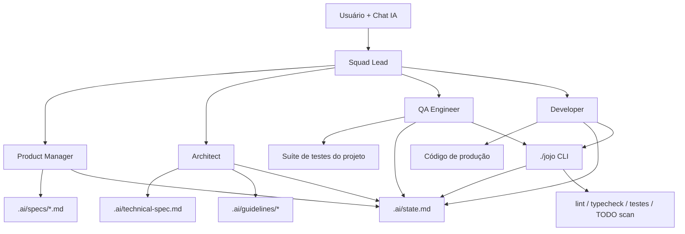
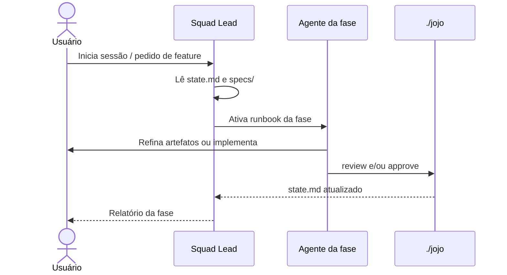

# Especificação Técnica: jojo-ai

**Última atualização:** 2026-07-26
**Versão:** 1.0
**Veredito arquitetural:** Confirmado

> Preenchido e mantido pelo agente Architect (`.ai/agents/architect.agent.md`). É o par técnico de `.ai/template.specs` (que é do PM, em linguagem de negócio) — juntos, esses dois arquivos são as únicas duas specs deste kit: **o quê** (requisito do app) e **como** (construção técnica).
>
> **Nota para `./jojo init`**: em projetos-alvo a CLI reinstala um esqueleto limpo deste arquivo. O conteúdo abaixo descreve o **produto jojo-ai** (este repositório meta), não a aplicação do cliente.

## 1. Visão Geral

O jojo-ai é um framework de processo e uma CLI local que impõem Spec-Driven Development a assistentes de codificação. Não é uma aplicação de negócio: o artefato principal é a pasta `.ai/` (agents, guidelines, skills, specs, estado) e o executável `./jojo` (Python 3, apenas stdlib), copiados para projetos via `init`.

## 2. Diagrama de Arquitetura

## 3. Fluxo Principal

## 4. Stack

| Camada | Tecnologia | Versão | Justificativa |
|--------|-----------|--------|---------------|
| CLI | Python 3 | 3.x | Stdlib apenas; portável, sem `pip install` no alvo |
| Artefatos de processo | Markdown + Gherkin | — | Legíveis por humanos e por IAs |
| Persistência de estado | `.ai/state.md` | — | Resiliente a troca de sessão/contexto |
| Integração com IAs | `agents.md` (régua única LLM-agnóstica) | — | Bootstrap de contexto por ferramenta |

## 5. Componentes & Contratos de Interface

| Componente | Responsabilidade | Tecnologia |
|-----------|-----------------|------------|
| `./jojo` | init, propose, status, sync, approve, reject, review | Python 3 |
| `.ai/agents/*.agent.md` | Runbooks por papel/fase (incl. UX Designer) | Markdown |
| `.ai/skills/*` | ui-ux, TDD, code-review, autonomous-loop | Markdown |
| `.ai/guidelines/*` | Arquitetura, FE/BE, design, convenções | Markdown |
| `.ai/specs/*` | Requisitos de feature | Markdown |
| `.ai/state.md` | Máquina de estados das specs | Markdown |

### Comandos da CLI

| Comando | Entrada | Efeito |
|---------|---------|--------|
| `init [dir]` | Diretório alvo | Copia kit sanitizado (sem specs de feature do meta-repo) |
| `propose` | Wizard interativo | Cria spec `draft` + linha em `state.md` |
| `status` | — | Renderiza tabela a partir de `state.md` |
| `sync` | Disco ↔ state | Registra specs órfãs como `draft`/`pm`; avisa paths ausentes |
| `approve` | Spec ativa ≠ `done` | Avança status/fase na tabela de transições |
| `reject` | Spec ativa ≠ `done` | Retrocede (code_review/tested ➔ test_red; senão um passo) |
| `review` | Workspace | Detecta stack, roda lint/type/test, bloqueia TODO/FIXME |

## 6. Dependências Externas

| Sistema | Tipo | Protocolo | Observações |
|--------|------|----------|-------|
| Git | Opcional | CLI local | `review` usa `git status` para arquivos modificados |
| Ferramentas da stack do app | Opcional | CLI local | ruff, pytest, npm, cargo, go, etc. |

## 7. Modelo de Dados

Não há banco de dados. O “modelo” é a tabela Markdown em `.ai/state.md`:

| Campo | Significado |
|-------|-------------|
| Código | `SPEC-NNN` |
| Título | Nome da feature |
| Caminho | Path do `.md` em `specs/` |
| Status Atual | `draft` … `done` |
| Fase Ativa | Agente/runbook corrente |
| Última Atualização | Data `YYYY-MM-DD` |

## 8. Riscos e Mitigações

| Risco | Severidade | Mitigação |
|-------|-----------|-----------|
| `init` copiar specs/estado do meta-repo para o projeto-alvo | 🟡 | `init` sanitiza specs (mantém só `000_setup`), reseta `technical-spec`, `features.feature`, `state` e docs de entrega |
| Stack não detectada no meta-repo (`jojo` sem `.py`) | 🟡 | Detecção por shebang/`jojo` e arquivos Python |
| IA editar fora do fluxo de fases | 🔴 | Regra absoluta em `global.instructions` + gates `approve`/`review` |
| Loop infinito de autocorreção | 🟡 | Stop após 3 falhas na mesma causa (`autonomous-loop.md`) |

## 9. Histórico de Decisões Arquiteturais

### 2026-07-26 — Fase e runbook de UI/UX no ciclo de vida
**Contexto:** O kit só tinha placeholders de design; features com interface pulavam descoberta de UX.
**Decisão:** Inserir status `ux_approved` e fase `ux` entre PM e Architect; agent `ux-designer` + skill `ui-ux`; enriquecer `design-premises.md`; atualizar CLI (`approve`/`reject`).
**Alternativas consideradas:** Só skill sem fase → UX continuaria opcional. Fase depois do Architect → tarde para contratos de UI.
**Trade-offs:** Ganha-se: gate formal de experiência / Perde-se: um `approve` a mais no fluxo feliz (7 em vez de 6).
**Consequências:** Features só-API usam N/A justificado na fase UX; CLI e docs alinhados.

### 2026-07-26 — Rewrite operacional de agents e skills
**Contexto:** Runbooks eram listas curtas; IAs pulavam gates e misturavam papéis.
**Decisão:** Padronizar cada agent com entradas, processo, gate de approve/reject, anti-padrões e handoff; skills com fontes da verdade, classificação de falhas e critérios de saída; índices README em `agents/` e `skills/`.
**Alternativas consideradas:** Manter runbooks mínimos → comportamento inconsistente entre sessões.
**Trade-offs:** Ganha-se: previsibilidade / Perde-se: arquivos mais longos no contexto (mitigado por disciplina RAG — ler só o agent da fase).
**Consequências:** Squad Lead deve anunciar fase e carregar um runbook por vez.

### 2026-07-26 — Comandos `sync`/`reject` e fechamento de gaps dos runbooks
**Contexto:** Validação do kit mostrou agents incompletos e ausência de CLI para retrocesso e sincronização de specs.
**Decisão:** Adicionar `./jojo sync` e `./jojo reject`; alinhar PM/QA/Developer/Squad Lead e skill TDD (spec ativa + Gherkin + code-review).
**Alternativas consideradas:** Edição manual de `state.md` → frágil e proibida pela regra absoluta.
**Trade-offs:** Ganha-se: fluxo reversível e sync programático / Perde-se: superfície de comandos um pouco maior.
**Consequências:** QA/PM usam `reject` em falha; Squad Lead usa `sync` na abertura de sessão.

### 2026-07-26 — Sanitização no `init` e baseline técnica do meta-repo
**Contexto:** Desenvolver o kit neste repositório e copiá-lo via `init` sem poluir o app-alvo com specs, ADRs e BDD do meta-produto.
**Decisão:** `init` copia a estrutura e em seguida reaplica um slate limpo (SPEC-000, technical-spec esqueleto, features placeholder, CHANGELOG/README de docs mínimos). O `technical-spec.md` deste repositório documenta o jojo-ai; nos alvos volta ao esqueleto.
**Alternativas consideradas:** Manter cópia bit-a-bit → polui projetos. Dois diretórios `template/` vs `product/` → complexidade extra.
**Trade-offs:** Ganha-se: meta-repo e projetos-alvo desacoplados / Perde-se: `init` deixa de ser um `cp -R` puro.
**Consequências:** Melhorias no kit (agents, CLI, skills) continuam sendo copiadas; rastro de features do meta-repo não.

### 2026-07-18 — CLI Python stdlib-only
**Contexto:** Precisar de uma CLI portável sem instalar dependências no projeto-alvo.
**Decisão:** Implementar `./jojo` em Python 3 usando apenas a biblioteca padrão.
**Alternativas consideradas:** Node/Go → exige toolchain extra no alvo.
**Trade-offs:** Ganha-se: zero setup / Perde-se: tipagem e empacotamento modernos.
**Consequências:** Qualquer máquina com Python 3 roda o kit.

## 10. Histórico de Versões

| Versão | Data | Mudança |
|--------|------|---------|
| 1.0 | 2026-07-26 | Baseline técnica do produto jojo-ai e política de sanitização do `init` |
| 0.1 | 2026-07-18 | Esqueleto inicial do repositório |
