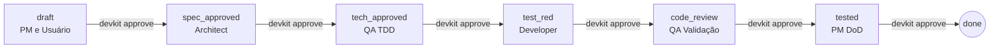

```
┌────────────────────────────────────────────────────────────────────┐
│                                                                    │
│   ██████╗ ███████╗██╗   ██╗██╗  ██╗██╗████████╗       █████╗ ██╗   │
│   ██╔══██╗██╔════╝██║   ██║██║ ██╔╝██║╚══██╔══╝      ██╔══██╗██║   │
│   ██║  ██║█████╗  ██║   ██║█████╔╝ ██║   ██║   █████╗███████║██║   │
│   ██║  ██║██╔══╝  ╚██╗ ██╔╝██╔═██╗ ██║   ██║   ╚════╝██╔══██║██║   │
│   ██████╔╝███████╗ ╚████╔╝ ██║  ██╗██║  ██║         ██║  ██║██║   │
│   ╚═════╝ ╚══════╝  ╚═══╝  ╚═╝  ╚═╝╚═╝   ╚═╝         ╚═╝  ╚═╝╚═╝   │
│                                                                    │
│        Dev ToolKit de IA — spec-driven · stateful · CLI            │
│              compatível com Claude Code e Gemini CLI               │
│                                                                    │
└────────────────────────────────────────────────────────────────────┘
```

## Sumário

1. [O que é isto](#1-o-que-é-isto)
2. [A CLI devkit — o motor do fluxo](#2-a-cli-devkit--o-motor-do-fluxo)
3. [Estrutura de Diretórios e Arquivos](#3-estrutura-de-diretórios-e-arquivos)
4. [Ciclo de Vida da Especificação (Fases)](#4-ciclo-de-vida-da-especificação-fases)
5. [Passo a Passo de Uso](#5-passo-a-passo-de-uso)
6. [Cada Peça, Explicada](#6-cada-peça-explicada)
7. [Perguntas Frequentes](#7-perguntas-frequentes)

---

## 1. O que é isto

`devkit-ai` é um **kit de inicialização e fluxo de desenvolvimento com estado (stateful)** para que assistentes de codificação de IA (como Claude Code ou Gemini CLI) trabalhem seguindo um processo disciplinado de Engenharia de Software, em vez de inventar sua própria forma de trabalhar.

Ele resolve os problemas comuns do desenvolvimento assistido por IA:
* **Falta de estrutura (Vibe Coding)**: O fluxo é estritamente orientado a especificações físicas e testes.
* **Persistência de Sessão**: O progresso do trabalho é persistido localmente no arquivo `.ai/state.md`. Se a sessão da IA cair ou você mudar de ferramenta, ela lê o estado e continua exatamente de onde parou.
* **Alucinação de Testes / Validações**: A CLI executável `./devkit review` roda fisicamente as ferramentas no seu computador para garantir que linters, builds e testes realmente passem antes de aceitar uma entrega.

---

## 2. A CLI devkit — o motor do fluxo

O kit acompanha um executável local escrito em Python 3 chamado `devkit` localizado na raiz do projeto. Ele gerencia o fluxo de trabalho através dos seguintes comandos:

```bash
# 1. Inicializa o devkit em um novo projeto
$ ./devkit init [diretório_alvo]

# 2. Wizard interativo para propor uma nova especificação
$ ./devkit propose

# 3. Exibe o painel de status de todas as especificações ativas
$ ./devkit status

# 4. Transiciona a especificação ativa para a próxima fase no state.md
$ ./devkit approve

# 5. Executa linter, typecheck, suíte de testes e varre por TODOs/FIXMEs
$ ./devkit review
```

---

## 3. Estrutura de Diretórios e Arquivos

```
devkit-ai/
│
├── .ai/                                  # Cérebro do toolkit — tudo que a IA lê
│   ├── global.instructions               # Regra Absoluta + Inicialização + Paradigmas
│   ├── state.md                          # ★ Painel central de tarefas e controle de progresso (estado)
│   ├── template.specs                    # Spec #1: Molde para requisitos de negócio
│   ├── technical-spec.md                 # Spec #2: Molde para modelagem e decisões técnicas
│   │
│   ├── specs/                            # Diretório das especificações ativas do projeto
│   │   ├── README.md
│   │   └── 000_setup.md                  # Primeira especificação (inicialização do projeto)
│   │
│   ├── agents/                           # Runbooks dos papéis desempenhados pela IA por fase
│   │   ├── squad-lead.agent.md           #   orquestrador do estado
│   │   ├── product-manager.agent.md      #   focado em negócio (draft) e DoD (tested)
│   │   ├── architect.agent.md            #   modelagem técnica (spec_approved)
│   │   ├── developer.agent.md            #   implementação de código (test_red)
│   │   └── qa.agent.md                   #   TDD (tech_approved) e Validação (code_review)
│   │
│   └── skills/                           # Procedimentos executados
│       ├── code-review.md                #   regras de aprovação automatizada
│       └── autonomous-loop.md            #   loop planejar→escrever→testar com autocorreção
│
├── docs/                                 # Documentação viva do produto final
│   ├── README.md                         #   Índice com link para as especificações completas
│   └── CHANGELOG.md                      #   Registro de alterações em linguagem de impacto
│
├── devkit                                # ★ Executável da CLI local
├── CLAUDE.md                             # Ponteiro de inicialização para o Claude Code
└── GEMINI.md                             # Ponteiro de inicialização para o Gemini CLI
```

---

## 4. Ciclo de Vida da Especificação (Fases)

O desenvolvimento de qualquer funcionalidade passa por um fluxo ordenado de status registrados no arquivo `.ai/state.md`:



Se em qualquer fase de validação (ex: no QA ou PM) o resultado for reprovado, o status retorna para `test_red` para o Developer aplicar correções.

---

## 5. Passo a Passo de Uso

### Passo 1: Inicializar o DevKit no seu Projeto
Copie a pasta `devkit-ai` para o seu computador e execute a CLI para inicializar a estrutura do devkit na pasta do seu projeto real:
```bash
$ ./devkit init /caminho/para/seu/projeto
```

### Passo 2: Propor uma Feature
Na raiz do seu projeto, execute o comando interativo para começar a esboçar os requisitos:
```bash
$ ./devkit propose
```
* O prompt perguntará o título, a user story básica e alguns requisitos simples.
* O arquivo `.ai/specs/001_sua_feature.md` será criado em estado `draft`.
* O arquivo `.ai/state.md` registrará a tarefa pendente.

### Passo 3: Refinar e Co-escrever no Chat da IA
Abra o chat da IA e envie:
> *"Vamos refinar e detalhar os requisitos da SPEC-001 juntos?"*

A IA lerá o arquivo de rascunho, assumirá o papel de **PM** e fará perguntas interativas até que a especificação esteja completa. Quando vocês concordarem com a especificação, digite no terminal local:
```bash
$ ./devkit approve
```
* O status mudará para `spec_approved`.

### Passo 4: Modelagem Técnica
Ao ver a mudança de estado para `spec_approved`, a IA assumirá o papel de **Architect** para criar a especificação técnica em `.ai/technical-spec.md` (diagramas, stack, interfaces).
Após aprovar a arquitetura no chat, rode no terminal local:
```bash
$ ./devkit approve
```
* O status mudará para `tech_approved`.

### Passo 5: Geração de Testes (QA/TDD)
A IA assumirá o papel de **QA** e escreverá a suíte de testes (fase vermelha - falhando). Ao finalizar, ela (ou você) executará:
```bash
$ ./devkit approve
```
* O status mudará para `test_red`.

### Passo 6: Desenvolvimento e Autoverificação
A IA assume o papel de **Developer**. Ela implementará o código para fazer os testes passarem.
Antes de terminar, a IA (ou você) executará obrigatoriamente:
```bash
$ ./devkit review
```
* Este comando varre o código buscando lints, erros de tipo, falhas de teste e marcadores como `TODO`/`FIXME` ou placeholders inacabados.
* Se falhar, a IA se autocorrige em loop (até 3 vezes).
* Se passar com sucesso (`APROVADO`), roda-se:
```bash
$ ./devkit approve
```
* O status mudará para `code_review`.

### Passo 7: Validação e DoD
O QA valida os testes no status `code_review`. Se passar, roda-se `./devkit approve` para mover para `tested`.
O PM valida os critérios do DoD na fase `tested`. Se passar, roda-se:
```bash
$ ./devkit approve
```
* A especificação é marcada como `done` (concluída), atualizando o `CHANGELOG.md` e o índice `README.md` automaticamente.

---

## 6. Cada Peça, Explicada

* **`.ai/state.md`**: É a fonte única de verdade do progresso. Ele garante que qualquer IA iniciada na sessão saiba exatamente em qual tarefa e fase está trabalhando, oferecendo resiliência absoluta a quedas de contexto.
* **`.ai/guidelines/`**: Diretrizes duráveis de codificação e arquitetura. O arquivo `architecture-guidelines.md` é atualizado na primeira especificação técnica para fixar a stack oficial do projeto, que passa a ser auditada pelo comando `./devkit review`.
* **`.ai/agents/`**: Runbooks focados e curtos que guiam o comportamento da IA para cada fase. Menos teatralidade, mais execução pragmática.

---

## 7. Perguntas Frequentes

**Posso pular fases se a mudança for pequena?**
Não é recomendado. Se a alteração for simples, o preenchimento de especificações e execução dos testes será extremamente rápido, mas a CLI `./devkit` garante que a consistência do projeto nunca seja quebrada.

**O que fazer se a IA travar em loop de build ou teste?**
De acordo com a skill `autonomous-loop.md`, o desenvolvedor de IA tentará no máximo 3 vezes resolver a mesma causa raiz. Se falhar, ela parará a execução e descreverá o problema no chat para você ajudar a decidir.

**Posso usar o DevKit em projetos que já existem?**
Sim. Rode `./devkit init` no repositório existente. Na primeira especificação, a IA lerá o código existente para preencher e documentar a stack atual nas guidelines.
