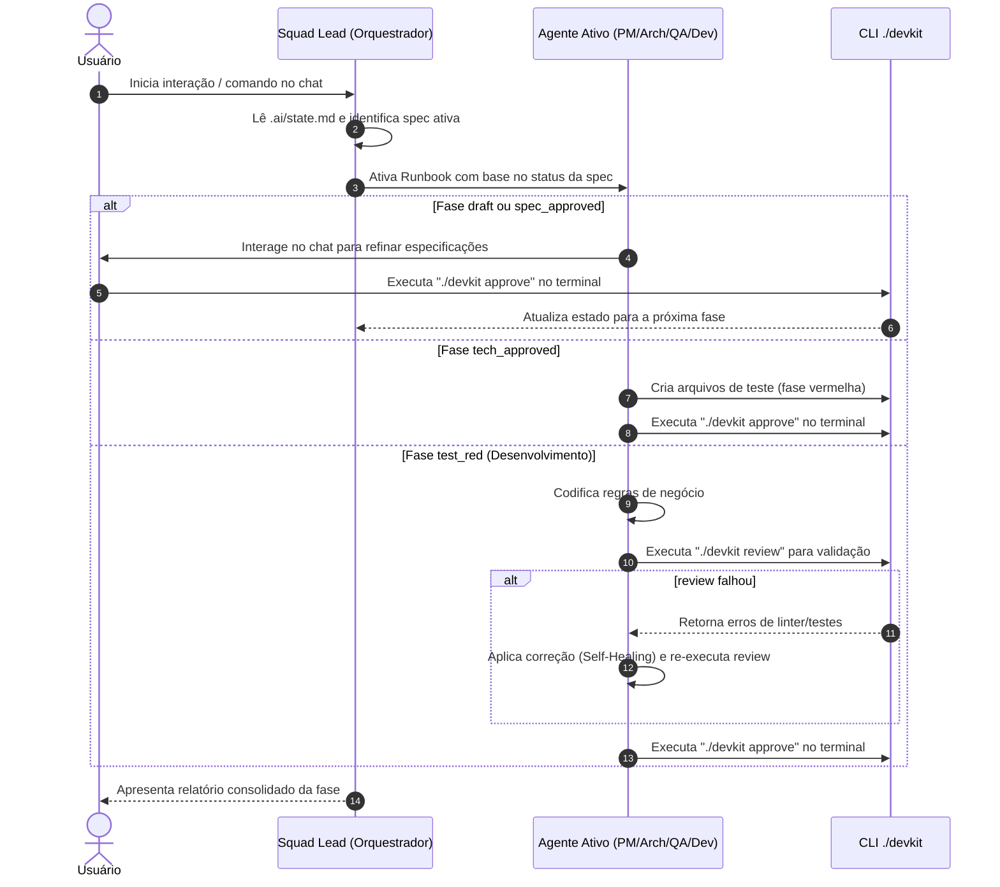

```
┌────────────────────────────────────────────────────────────────────┐
│                                                                    │
│   ██████╗ ███████╗██╗   ██╗██╗  ██╗██╗████████╗       █████╗ ██╗   │
│   ██╔══██╗██╔════╝██║   ██║██║ ██╔╝██║╚══██╔══╝      ██╔══██╗██║   │
│   ██║  ██║█████╗  ██║   ██║█████╔╝ ██║   ██║   █████╗███████║██║   │
│   ██║  ██║██╔══╝  ╚██╗ ██╔╝██╔═██╗ ██║   ██║   ╚════╝██╔══██║██║   │
│   ██████╔╝███████╗ ╚████╔╝ ██║  ██╗██║  ██║          ██║  ██║██║   │
│   ╚═════╝ ╚══════╝  ╚═══╝  ╚═╝  ╚═╝╚═╝   ╚═╝         ╚═╝  ╚═╝╚═╝   │
│                                                                    │
│        Dev ToolKit de IA — spec-driven · stateful · CLI            │
│              compatível com Claude Code e Gemini CLI               │
│                                                                    │
└────────────────────────────────────────────────────────────────────┘
```

# DevKit-AI

Framework de desenvolvimento guiado por especificações (Spec-Driven Development), controle de estado persistente e validação automatizada de código para assistentes de Inteligência Artificial.

## Sumário

0. **[Guia do Usuário (didático, contínuo)](docs/GUIA-DO-USUARIO.md)** ← comece por aqui se for humano usando o kit  
1. [Visão Geral](#1-visão-geral)
2. [Arquitetura de Diretórios](#2-arquitetura-de-diretórios)
3. [Interface de Linha de Comando (CLI)](#3-interface-de-linha-de-comando-cli)
4. [Ciclo de Vida e Estados da Especificação](#4-ciclo-de-vida-e-estados-da-especificação)
5. [Fluxo de Comunicação e Validação](#5-fluxo-de-comunicação-e-validação)
6. [Guias de Inicialização](#6-guias-de-inicialização)
7. [Protocolos de Robustez e Resiliência](#7-protocolos-de-robustez-e-resiliência)

> **Novo no kit?** Não leia este README de ponta a ponta primeiro. Abra o **[Guia do Usuário](docs/GUIA-DO-USUARIO.md)** (capítulos 1→4), rode `./devkit doctor` e só depois volte aqui como referência.

---

## 1. Visão Geral

O **DevKit-AI** é um ecossistema projetado para estruturar o fluxo de trabalho de assistentes de codificação de Inteligência Artificial (como Claude Code e Gemini CLI). O framework substitui abordagens de desenvolvimento não estruturadas por um pipeline rigoroso baseado em três pilares fundamentais:

* **Desenvolvimento Orientado a Especificação (SDD)**: O código de produção e de teste só é gerado após o alinhamento de especificações de negócio e modelagens técnicas explícitas.
* **Persistência de Estado (Stateful)**: O progresso da implementação é registrado localmente em arquivo Markdown (`.ai/state.md`), garantindo resiliência a quedas de contexto e alternância de sessões da IA.
* **Validação Física Programática**: Uma CLI local (`./devkit review`) executa builds, linters e suítes de testes, além de varrer arquivos em busca de marcações incompletas, eliminando a aceitação de códigos com base em alucinações da IA.

---

## 2. Arquitetura de Diretórios

O fluxo de informações do toolkit é distribuído nas seguintes pastas e artefatos estruturados:

```
devkit-ai/
│
├── .ai/                                  # Diretório de controle interno
│   ├── global.instructions               # Instruções de RAG, disciplina de contexto e inicialização
│   ├── state.md                          # Painel centralizador de tarefas e estados (Task Tracker)
│   ├── template.specs                    # Modelo de especificação funcional de requisitos
│   ├── technical-spec.md                 # Arquitetura e decisões de projeto (ADR); esqueleto limpo no init
│   ├── features.feature                  # Cenários Gherkin (BDD) da feature ativa
│   │
│   ├── specs/                            # Diretório de especificações ativas da aplicação
│   │   ├── README.md                     # Diretrizes de organização de arquivos de especificação
│   │   └── 000_setup.md                  # Especificação inicial de configuração (baseline)
│   │
│   ├── agents/                           # Runbooks operacionais de IA por fase de execução
│   │   ├── README.md                     #   Índice status → agent
│   │   ├── squad-lead.agent.md           #   Orquestrador (sync, gates, handoff)
│   │   ├── product-manager.agent.md      #   Spec de negócio + DoD
│   │   ├── ux-designer.agent.md          #   UI/UX (fluxos, estados, design system)
│   │   ├── architect.agent.md            #   Tech-spec, stack, contratos
│   │   ├── developer.agent.md            #   Implementação + review
│   │   └── qa.agent.md                   #   TDD (RED) + validação (GREEN)
│   │
│   ├── skills/                           # Procedimentos de engenharia
│   │   ├── README.md                     #   Índice skill → quem usa
│   │   ├── ui-ux.md                      #   Checklist de UX/UI e a11y
│   │   ├── tdd.md                        #   RED → GREEN → REFACTOR + prova de RED
│   │   ├── code-review.md                #   ./devkit review + checklist de diff
│   │   └── autonomous-loop.md            #   Self-heal com limite de 3 tentativas
│   │
│   └── guidelines/                       # Premissas permanentes do workspace
│       ├── design-premises.md            #   UI/UX e premissas de produto
│       ├── architecture-guidelines.md    #   Stack e clean architecture
│       ├── backend-guidelines.md         #   Padrões de backend
│       ├── frontend-guidelines.md        #   Padrões de frontend
│       └── conventions.md                #   Nomenclatura, commits, imports
│
├── docs/                                 # Documentação do produto final (entregas)
│   ├── README.md                         # Índice com link para as especificações implementadas
│   └── CHANGELOG.md                      # Histórico de alterações e impacto no negócio
│
├── devkit                                # Executável da CLI local (Python 3, stdlib)
├── CLAUDE.md                             # Configuração de contexto padrão para Claude Code
├── GEMINI.md                             # Configuração de contexto padrão para Gemini CLI
└── SYSTEM_PROMPT.md                      # Prompt de adaptação do kit a um projeto novo
```

---

## 3. Interface de Linha de Comando (CLI)

A CLI `./devkit` é o mecanismo responsável pela governança do repositório local.

```bash
$ ./devkit <comando> [argumentos]
```

### Comandos Disponíveis:

* **`init [diretório_alvo]`**: Copia `.ai/`, `docs/`, `hooks/`, workflow CI e o executável; **sanitiza** o slate do alvo (só `SPEC-000`, tech-spec limpo, etc.).
* **`propose`**: Wizard interativo **ou** flags: `--title` `--persona` `--want` `--so-that` `--req` (repetível).
* **`hotfix --title T [--reason R]`**: Spec de emergência em `tech_approved` (pula PM estendido, UX e Architect; exige auditoria no DoD/CHANGELOG).
* **`status`**: Painel ASCII das specs e fases.
* **`sync [--migrate-lifecycle]`**: Specs órfãs → `draft`; com flag, corrige fases legadas (ex.: `spec_approved`+`architect` → `ux`).
* **`activate SPEC-N`**: Coloca a spec no topo da fila do `approve`/`reject`.
* **`approve` / `reject`**: Avança ou retrocede a spec ativa (inclui `ux_approved`).
* **`review`**: Lint, typecheck, testes, TODO/FIXME e **heurísticas de UI** (avisos).
* **`doctor`**: Valida integridade do kit (arquivos, state↔specs, fases, sintaxe da CLI).
* **`log [--limit N]`**: Histórico do `state.md` + `.ai/metrics.jsonl`.

---

## 4. Ciclo de Vida e Estados da Especificação

O desenvolvimento de qualquer mudança de código segue a máquina de estados abaixo gerenciada programaticamente. A coluna **Fase Ativa** é o runbook vigente enquanto o status atual não é aprovado; **Próximo Status** é o resultado de `./devkit approve`.

| Status Atual | Fase Ativa | Responsável | Ação Esperada | Próximo Status (pós-`approve`) |
| :--- | :--- | :--- | :--- | :--- |
| **`draft`** | `pm` | Product Manager | Co-escreve requisitos em `.ai/specs/<nome>.md` | `spec_approved` |
| **`spec_approved`** | `ux` | UX / UI Designer | Fluxos, estados de UI, design system (§3 da spec + skill ui-ux) | `ux_approved` |
| **`ux_approved`** | `architect` | Architect | Modelagem técnica e diagramas em `.ai/technical-spec.md` | `tech_approved` |
| **`tech_approved`** | `qa_tdd` | QA (TDD) | Suíte de testes automatizados (fase vermelha) | `test_red` |
| **`test_red`** | `developer` | Developer | Código de produção até `./devkit review` APROVADO | `code_review` |
| **`code_review`** | `qa_validation` | QA (Validação) | Validação de testes e regressões | `tested` |
| **`tested`** | `pm_dod` | PM (DoD) | DoD + documentação | `done` |
| **`done`** | `done` | — | Feature concluída | — |

---

## 5. Fluxo de Comunicação e Validação

O diagrama a seguir descreve a orquestração de chamadas entre o usuário, o orquestrador (Squad Lead), os runbooks específicos dos agentes e a CLI executável:



---

## 6. Guias de Inicialização

### Cenário A: Projetos Novos (Do Zero)

1. **Inicialização da Estrutura**:
   ```bash
   $ ./devkit init /caminho/do/projeto
   ```
2. **Proposta de Feature**:
   ```bash
   $ ./devkit propose
   ```
   Responda às perguntas interativas para registrar a especificação inicial em `.ai/specs/`.
3. **Refinamento Cooperativo**:
   Inicie a IA de código e solicite o refinamento da especificação no chat.

---

### Cenário B: Projetos Existentes (Em Desenvolvimento)

Caso o projeto já possua código de produção ativo, o DevKit-AI atua mapeando o sistema sem sobrescrever implementações existentes:

1. **Inicialização no Repositório**:
   Execute a CLI passando o diretório atual como alvo:
   ```bash
   $ /caminho/do/devkit-ai/devkit init .
   ```
2. **Execução do Mapeamento Inicial**:
   Abra a interface de chat com a IA e envie o seguinte comando de mapeamento arquitetural:
   > "Aja como o Architect. Leia o código existente deste repositório e preencha as diretrizes de arquitetura em `.ai/guidelines/architecture-guidelines.md` e a especificação técnica baseline em `.ai/technical-spec.md`."
   * A IA fará a varredura da estrutura de arquivos de produção existentes, identificará pacotes e dependências e registrará o estado atual como baseline em `SPEC-000` (Setup Inicial, com status `done`).
3. **Parametrização Visual**:
   Abra `.ai/guidelines/design-premises.md` e insira as restrições estéticas (cores, biblioteca de componentes, regras de formulários) que a aplicação já segue.

---

## 7. Protocolos de Robustez e Resiliência

### Detecção de Conflitos e Alterações de Escopo
Se um arquivo de especificação ativo (`.md` em `.ai/specs/`) for alterado manualmente no meio do ciclo de desenvolvimento, o orquestrador (`squad-lead.agent.md`) identificará a alteração durante a análise de inicialização da sessão. O estado da tarefa ativa será retrocedido no `.ai/state.md` para a fase correspondente à alteração (ex: de `test_red` de volta para `spec_approved`), instruindo o usuário sobre a inconsistência detectada.

### Condições de Parada e Autocorreção (Self-Healing)
Quando a IA de desenvolvimento se depara com falhas de compilação ou de testes durante o comando `./devkit review`, ela executa o ciclo de correção estipulado em `.ai/skills/autonomous-loop.md`.
A execução autônoma é interrompida e escalada para o usuário no chat caso:
- Ocorram **3 falhas consecutivas** sob a mesma causa raiz.
- A correção exija dependências ou alterações arquiteturais externas à especificação técnica aprovada.
- Ocorram erros de infraestrutura local não relacionados ao código (ex: portas de rede ocupadas, serviços externos caídos).
