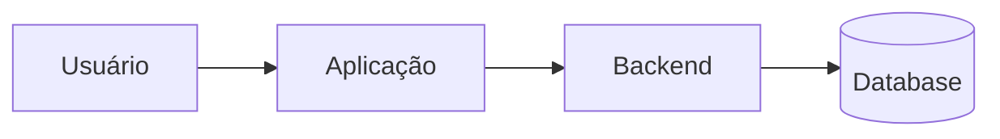

# System Design — [Nome do Projeto]

> **Arquivo humano do SPECKIT (junto com `agents.md`).**  
> Cada projeto tem o **seu** system design. Agentes e skills **devem ler este arquivo** antes de desenhar UI, modelar arquitetura ou implementar código.  
> Preencha as seções. O que não se aplicar: marque `N/A` com 1 linha de motivo.

**Última atualização:** [AAAA-MM-DD]  
**Versão do design:** 0.1  
**Projeto (espelho de agents.md):** [Nome do Projeto]

---

## 1. Visão de sistema

**Problema que o sistema resolve:**  
[1–3 frases]

**Limites do sistema (o que está dentro / fora):**  
- Dentro: …
- Fora: …

**Atores / sistemas externos:**  
| Ator / sistema | Papel |
| --- | --- |
| [Usuário final] | … |
| [API parceira] | … |

**Diagrama (texto ou mermaid):**



---

## 2. Arquitetura

### 2.1 Estilo

- [ ] Monólito modular
- [ ] Modular monolito + jobs
- [ ] Serviços separados
- [ ] Outro: …

**Justificativa (1–3 linhas):** …

### 2.2 Camadas / pastas (obrigatório alinhar com Ducks / features)

```
src/
├── [features|ducks]/
│   └── [feature]/
├── shared/
└── …
```

**Regra de dependência:**  
[ex.: domain não importa infra; UI não acessa SQL direto]

### 2.3 Stack (detalhe técnico — agents.md tem o resumo)

| Camada | Tecnologia | Versão | Notas |
| --- | --- | --- | --- |
| Frontend | | | |
| Backend | | | |
| Database | | | |
| Auth | | | |
| Jobs / filas | | | |
| Testes | | | |
| CI/CD | | | |

### 2.4 Dados

**Entidades principais:**  
| Entidade | Dono | Persistência | Observações |
| --- | --- | --- | --- |
| | | | |

**Regras de consistência / transações:** …  
**Migrations:** [como e quem aplica]

### 2.5 Integrações

| Sistema | Direção | Protocolo | Falha esperada |
| --- | --- | --- | --- |
| | in / out / bi | HTTP / queue / … | retry / DLQ / … |

### 2.6 Segurança & compliance

- Authn: …
- Authz: …
- Segredos: [env only / vault]
- Dados sensíveis / PII: …
- Auditoria: …

### 2.7 Não-funcionais

| Requisito | Meta | Como medimos |
| --- | --- | --- |
| Latência p95 | | |
| Disponibilidade | | |
| Escala | | |

---

## 3. Design de produto & UI (Design System)

> Se o projeto **não tem UI**, preencha §3 com `N/A — sem interface` e pule subseções.

### 3.1 Premissas de produto

- Tom de voz: [formal / direto / amigável]
- Plataformas: [web desktop / mobile / ambos]
- Acessibilidade alvo: [WCAG 2.1 AA / …]
- Idiomas: [pt-BR / …]

### 3.2 Fundação visual

| Token | Valor / referência |
| --- | --- |
| Cores primárias | |
| Cores semânticas (success/warn/error) | |
| Tipografia | |
| Espaçamento base | |
| Radius / sombra | |
| Densidade | |

### 3.3 Componentes e biblioteca

- Design system / lib: [ex.: shadcn, MUI, interno]
- Onde vivem componentes: `src/shared/components/…`
- **Não recriar** sem ADR: Button, Input, Modal, …

### 3.4 Estados obrigatórios (por superfície)

Toda tela/lista/form async deve prever:

| Estado | Obrigatório |
| --- | --- |
| Default / populated | sim |
| Loading | se async |
| Empty | se coleção |
| Error + retry | se async |
| Submitting / disabled | se form |

### 3.5 Navegação & layout

- Shell: [sidebar / top nav / …]
- Rotas principais: …
- Deep links / URL state: [sim/não]

### 3.6 Microcopy

- CTA: verbo + objeto
- Erros: o que falhou + o que fazer
- Empty: próximo passo

---

## 4. Decisões de design (ADR leve)

Registre decisões que os agentes **não podem** reverter sozinhos.

| ID | Data | Decisão | Status |
| --- | --- | --- | --- |
| SD-001 | | | proposed / accepted / superseded |

Detalhe (opcional):

### SD-001 — [título]
- **Contexto:**  
- **Decisão:**  
- **Consequências:**  

---

## 5. Fora de escopo de design (explícito)

- …
- …

---

## 6. Como agentes usam este arquivo

Este arquivo fica na **raiz** (junto com `agents.md` e `CHANGELOG.md`).  
Runbooks e skills: `kit/docs/agents/`, `kit/docs/skills/`.

| Papel | O que ler aqui |
| --- | --- |
| Squad Lead | Confirmar que o arquivo existe; se vazio, pedir preenchimento antes de codar |
| Product Manager | Limites do sistema (§1), atores, fora de escopo |
| UX Designer | **§3 inteira** — fonte do design system; não inventar tokens/libs |
| Architect | **§2 inteira** + ADRs §4; alinhar technical-spec |
| QA | Contratos implícitos, estados UI, NFR |
| Developer | §2 + §3 + Ducks; zero desvio sem atualizar este arquivo + aceite humano |

**Regra:** conflito entre chat e este arquivo → **vence `system-design.md`** (ou peça ao humano para atualizá-lo).  
**Regra:** mudança estrutural de arquitetura ou design system → atualizar este arquivo **antes** ou **junto** com o código, com aceite humano.

---

## Checklist de prontidão (DoR de design)

- [ ] §1 preenchida (visão + limites)
- [ ] §2 stack e camadas definidas (ou “primeira feature define”, anotado)
- [ ] §3 preenchida **ou** N/A justificado
- [ ] Guardrails de `agents.md` não contradizem este arquivo
- [ ] Humano revisou este arquivo ao menos uma vez
